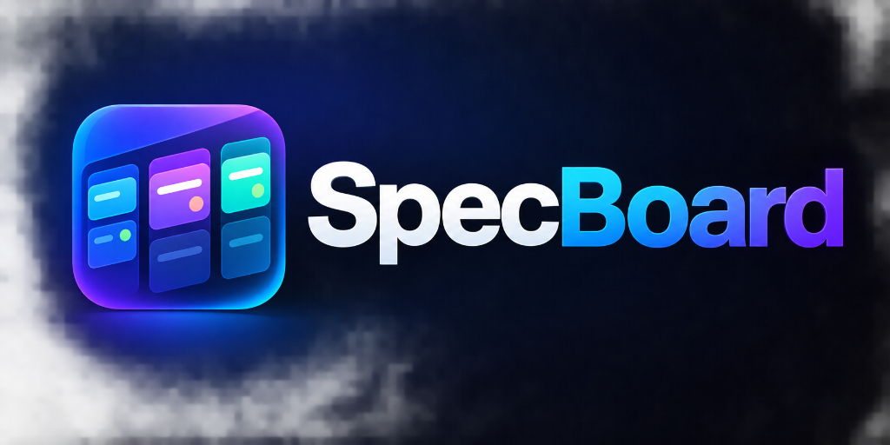
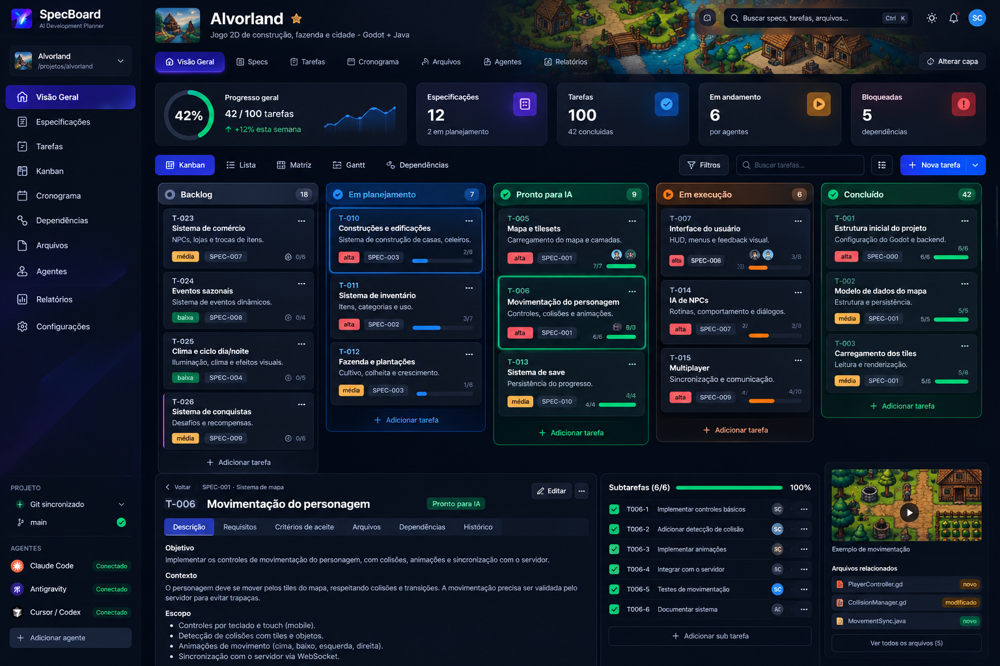
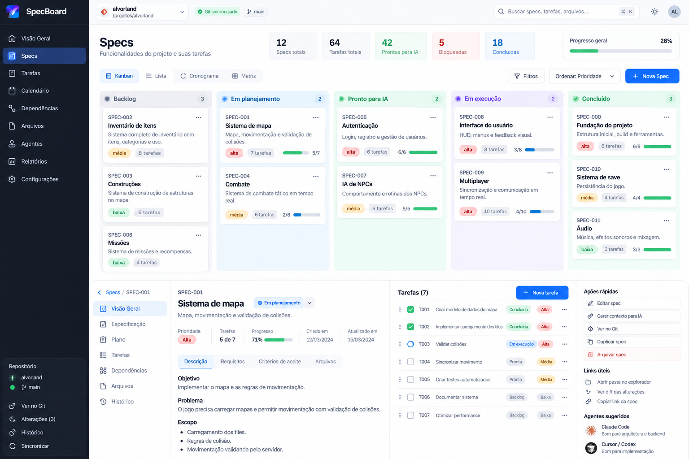

<div align="center">

  

  # SpecBoard
  ### 🚀 AI Development Planner

  **A ferramenta local e visual definitiva para planejar, documentar e organizar projetos orientados a agentes de IA.**

  [](https://vuejs.org/)
  [](https://www.typescriptlang.org/)
  [](https://vitejs.dev/)
  [](https://vuetifyjs.com/)
  [](https://vitest.dev/)
  [](LICENSE)

  <br />

  <p align="center">
    <a href="#-visão-geral">Visão Geral</a> •
    <a href="#-principais-recursos">Recursos</a> •
    <a href="#-galeria">Galeria</a> •
    <a href="#-como-executar">Como Executar</a> •
    <a href="#-estrutura-documental">Estrutura de Arquivos</a> •
    <a href="#-arquitetura-e-segurança">Arquitetura & Segurança</a>
  </p>

</div>

---

## 🌟 Visão Geral

Ao desenvolver softwares complexos com múltiplos agentes autônomos de programação (como **Claude Code**, **Antigravity**, **Cursor** ou **Codex**), o escopo facilmente se perde no histórico de conversas e os arquivos ficam desorganizados.

O **SpecBoard** resolve isso oferecendo uma camada visual moderna de alto nível (estilo Kanban / Trello) para orquestrar especificações técnicas (**Specs**), requisitos verificáveis e tarefas técnicas granulares diretamente sobre o seu repositório Git local.

> 💡 **Princípio Central:** Arquivos versionados em **Markdown e YAML** são a **única fonte da verdade**. Não há bancos de dados remotos proprietários, nem lock-in. A interface lê e grava diretamente nos arquivos do seu projeto com segurança atômica e prevenção de conflitos.

---

## 📸 Galeria

<div align="center">
  
  <p><em>Visão Geral no Tema Escuro: Métricas em tempo real, Kanban de tarefas e detalhes estruturados.</em></p>
</div>

<br />

<div align="center">
  
  <p><em>Tema Claro com suporte responsivo a desktop e tablets.</em></p>
</div>

---

## ✨ Principais Recursos

### 🗂️ 1. Multi-Projetos & Alternância Instantânea
- **Troca Rápida de Projetos:** Alterne entre múltiplos repositórios com um clique pelo menu suspenso lateral.
- **Seletor Nativo do Windows:** Abre a janela padrão do Windows Explorer para navegar e selecionar a pasta do projeto graficamente.
- **Histórico Persistente:** Seus projetos recentes e o último repositório aberto são lembrados automaticamente via `localStorage`.

### 📋 2. Kanban de Tarefas & Especificações
- **Drag & Drop Fluido:** Mova cartões entre colunas (*Backlog, Em Planejamento, Pronto para IA, Em Execução, Em Revisão, Concluído e Bloqueado*).
- **Acessibilidade por Teclado:** Mova tarefas rapidamente usando atalhos (`Alt + Setas`) ou pelo menu contextual do cartão.
- **Kanban de Specs:** Visualize o progresso de cada especificação técnica e crie novas Specs usando templates automáticos.

### 🔍 3. Modal de Detalhes Estilo Trello
- **Visualização Completa:** Exibe descrição em Markdown, requisitos referenciados, critérios de aceite verificáveis, arquivos previstos e dependências.
- **Transição Rápida de Status:** Seletor lateral integrado para alterar o estado da tarefa sem fechar a janela.
- **Justificativa de Bloqueio:** Tarefas bloqueadas exigem e exibem o motivo técnico do impedimento.

### 🤖 4. Exportação de Contexto para IA ("Copiar Contexto")
- Gere instantaneamente com um clique um pacote Markdown enriquecido contendo a Tarefa, Spec, Plano Técnico, Regras Globais do Projeto e Critérios de Aceite para colar diretamente no prompt do seu agente autônomo (Claude Code, Antigravity, etc.).

### 🎨 5. Personalização de Logo e Capa Panorâmica
- Escolha e visualize o avatar e a imagem de capa panorâmica de cada projeto.
- **Otimização Inteligente via Canvas:** Redimensiona e comprime imagens automaticamente no navegador (WebP/JPEG), evitando sobrecarga.
- **Armazenamento no IndexedDB:** Sem limites de tamanho ou problemas de quota (`QuotaExceededError`).

### 🔒 6. Gravação Segura & Resolução de Conflitos
- **Escrita Atômica:** Valida hashes SHA-256 antes de gravar. Se alguém (ou um agente) modificar o arquivo externamente, o SpecBoard detecta a alteração e exibe um modal de **Diff Interativo** para que você decida se deseja reaplicar, mesclar ou sobrescrever.
- **Preservação de Conteúdo:** Comentários humanos, metadados desconhecidos e formatação fora dos blocos YAML são 100% preservados na leitura e escrita.

### 📊 7. Análise de Dependências & Métricas Técnicas
- **Grafo de Dependências:** Detecção automática de dependências inexistentes e ciclos no grafo direcionado.
- **Candidatas a Paralelismo:** Identifica tarefas que estão prontas para serem executadas simultaneamente sem conflito de arquivos.
- **Fórmulas Reais:** Métricas que distinguem progresso documental de cobertura de planejamento.

---

## 🛠️ Stack Tecnológica

| Camada | Tecnologias Utilizadas |
|---|---|
| **Frontend** | [Vue 3](https://vuejs.org/) (Composition API, `<script setup>`), [TypeScript](https://www.typescriptlang.org/) (strict mode) |
| **Tooling & Build** | [Vite 6](https://vitejs.dev/), [vue-tsc](https://github.com/vuejs/language-tools) |
| **Componentes & UI** | [Vuetify 3](https://vuetifyjs.com/), [@mdi/font](https://pictogrammers.com/library/mdi/) |
| **Roteamento & Estado** | [Vue Router 4](https://router.vuejs.org/), [Pinia](https://pinia.vuejs.org/) (apenas para estado transitório) |
| **Parsers & Markdown** | [yaml](https://eemeli.org/yaml/), [marked](https://marked.js.org/), [dompurify](https://github.com/cure53/DOMPurify) |
| **Backend Local** | Node.js nativo integrado como plugin Vite (`/api/specboard`), PowerShell STA para seletor nativo |
| **Testes & Qualidade** | [Vitest](https://vitest.dev/), [ESLint](https://eslint.org/), [Prettier](https://prettier.io/) |

---

## 🚀 Como Executar

### Pré-requisitos
- **Node.js** v20 ou superior
- **Git** instalado no sistema

### 1. Clonar o repositório
```bash
git clone https://github.com/sidneyfilho/SpecBoard.git
cd SpecBoard
```

### 2. Instalar dependências
```bash
npm install
```

### 3. Iniciar o ambiente de desenvolvimento
```bash
npm run dev
```
Acesse em seu navegador: **http://localhost:5173**

### 4. Scripts disponíveis
```bash
npm test            # Executa a suite de testes unitários com Vitest
npm run typecheck   # Checagem estrita de tipos com vue-tsc
npm run lint        # Verificação de qualidade de código com ESLint
npm run build       # Build otimizado de produção
npm run preview     # Pré-visualização do build de produção
```

---

## 📁 Estrutura Documental Suportada

O SpecBoard organiza o desenvolvimento através de uma estrutura simples e limpa em pastas versionadas no Git:

```text
meu-projeto/
├── .specboard/
│   ├── project.yaml            # Metadados do projeto (id, nome, diretórios)
│   └── constitution.md         # Regras de arquitetura e diretrizes permanentes
├── AGENTS.md                   # Instruções globais para os agentes de IA
└── specs/
    ├── 001-autenticacao/
    │   ├── spec.md             # Requisitos de produto e critérios de aceite
    │   ├── plan.md             # Plano técnico e abordagem de arquitetura
    │   └── tasks.md            # Tarefas técnicas detalhadas (blocos YAML)
    └── 002-dashboard/
        ├── spec.md
        ├── plan.md
        └── tasks.md
```

### Exemplo de Bloco de Tarefa (`tasks.md`)
```markdown
# Tarefas — SPEC-001

## T001 — Configurar autenticação OAuth2
<!-- task:begin -->
id: T001
status: ready
priority: high
depends_on: []
parallel_group: auth-core
spec_refs: [REQ-001]
files:
  - src/auth/service.ts
acceptance:
  - Login via Google gera token JWT válido
  - Tokens expirados são rejeitados com 401
<!-- task:end -->

Descrição detalhada da tarefa em Markdown livre. Comentários e notas
são preservados intactos pelo parser cirúrgico do SpecBoard.
```

---

## 🛡️ Arquitetura e Segurança

1. **Acesso Restrito ao Repositório:** O backend local valida e restringe todas as operações exclusivamente à pasta autorizada pelo usuário, bloqueando qualquer tentativa de *path traversal* (`../`, caminhos absolutos forçados ou acesso à pasta `.git`).
2. **Sem Execução de Código Arbitrário:** O SpecBoard não executa scripts contidos nos projetos e não possui terminal embutido para execução de comandos de terceiros.
3. **Higienização de Conteúdo:** Todo Markdown é sanitizado com `DOMPurify` para neutralizar ataques XSS.
4. **Proteção Anti-Conflito:** Ao gravar tarefas ou documentos, a aplicação confere o hash original do arquivo. Se houver divergência, recusa a sobrescrita silenciosa e aciona a conciliação manual.

---

## 📄 Licença

Distribuído sob a licença **MIT**. Veja `LICENSE` para mais informações.

<br />

<div align="center">
  <sub>Construído com dedicação para a nova era do desenvolvimento acelerado por IA.</sub>
</div>
